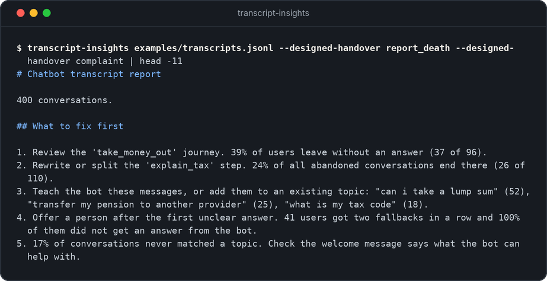

# transcript-insights

Turn chatbot transcripts into a short list of what to fix first.



The tool reads conversation logs and works out where users get stuck, what the bot does not understand and which journeys lose the most people. The report starts with recommendations in plain English.

## The problem it solves

Most chatbot teams have thousands of transcripts and no time to read them. Dashboards show a containment number, but not why it is low or what to change.

This tool answers the questions a conversation designer asks in a review:

- Which journey loses the most users?
- Which single message do people leave at?
- What are users asking for that the bot was never taught?
- What happens after the bot says "I did not understand" twice?

## Try it

You need Python 3.10 or later. The tool has no other dependencies.

```bash
git clone https://github.com/Welchlea/transcript-insights.git
cd transcript-insights
pip install -e ".[dev]"
```

Build the report from the example data:

```bash
transcript-insights examples/transcripts.jsonl --designed-handover report_death --designed-handover complaint
```

The full output is in [`examples/report.md`](examples/report.md). It starts like this:

```text
# Chatbot transcript report

400 conversations.

## What to fix first

1. Review the 'take_money_out' journey. 39% of users leave without an answer (37 of 96).
2. Rewrite or split the 'explain_tax' step. 24% of all abandoned conversations end there (26 of 110).
3. Teach the bot these messages, or add them to an existing topic: "can i take a lump sum" (52), "transfer my pension to another provider" (25), "what is my tax code" (18).
4. Offer a person after the first unclear answer. 41 users got two fallbacks in a row and 100% of them did not get an answer from the bot.
5. 17% of conversations never matched a topic. Check the welcome message says what the bot can help with.

## Headline measures

| Measure | Value | What it means |
| --- | --- | --- |
| Containment | 58% | Resolved by the bot, leaving out handovers that are by design |
| Resolved | 52% | The user got what they came for from the bot |
| Handed over | 20% | Passed to a person. 41 of 81 were by design |
| Abandoned | 28% | The user left part way through |
| Fallback rate | 11% | Bot messages that were 'I did not understand' |
| Average length | 5.7 | Messages in a conversation, from both sides |
```

## What the example report found

The example data is made up, but it has the kind of problems real services have. The report finds each one.

| Finding | What a designer would do next |
| --- | --- |
| Users leave the withdrawal journey at the tax message | Read the message. It has a 32 word sentence full of tax terms. Split it and use plain words. |
| "Can I take a lump sum?" is the most common message the bot does not understand | It is the same need as the withdrawal journey in different words. Add it to that topic. |
| Nobody who gets two fallbacks in a row is helped by the bot | Offer a person after the first fallback, not the second. |
| Bereavement and complaints always go to a person | Leave them alone. That is the design working. |

## Measures

| Measure | How it is worked out |
| --- | --- |
| Containment | Conversations resolved by the bot, divided by all conversations except handovers that are by design. |
| Resolved | Conversations where the outcome is `resolved`. |
| Handed over | Conversations passed to a person. |
| Abandoned | Conversations where the user left part way through. |
| Fallback rate | Bot messages marked as a fallback, divided by all bot messages. |
| Where users give up | The last bot step in each abandoned conversation. |
| What the bot did not understand | User messages that came straight before a fallback. Capital letters and punctuation are removed so the same message groups together. |
| Repeated fallbacks | Conversations with two or more fallbacks in a row, and how many of those the bot did not resolve. |

### Handovers by design

Some topics should always go to a person. If every handover counts as a failure, a team is pushed to keep bereaved users in the bot to protect a number.

`--designed-handover` names those topics. They are left out of containment and never appear in the recommendations.

## Transcript format

One conversation on each line, in JSON:

```json
{"id": "c0001", "outcome": "abandoned", "turns": [
  {"speaker": "user", "text": "Can I take a lump sum?", "intent": null},
  {"speaker": "bot", "text": "Sorry, I did not understand.", "step": "fallback", "fallback": true}
]}
```

| Field | Meaning |
| --- | --- |
| `outcome` | `resolved`, `handover` or `abandoned` |
| `intent` | On user turns. The topic the bot matched, or `null` if none |
| `step` | On bot turns. The name of the step that sent the message |
| `fallback` | On bot turns. `true` when the bot did not understand |

Most chatbot platforms can export these fields. They may use different names, so you may need a small script to rename them.

## Other options

```bash
# Save the report
transcript-insights examples/transcripts.jsonl --out reports/march.md

# Results as JSON for another tool
transcript-insights examples/transcripts.jsonl --format json

# Longer lists
transcript-insights examples/transcripts.jsonl --top 10
```

## Design decisions

- **Recommendations first, tables second.** The reader should know what to do before they see a number.
- **Every recommendation shows its evidence.** "39% of users leave (37 of 96)" can be checked. "Improve this journey" cannot.
- **Small topics are left out of recommendations.** A topic needs at least 20 conversations before the tool will call it a problem.
- **Handovers by design are protected.** See above.
- **No language model.** Counting is enough to find the biggest problems, and the results are the same every time.

## Limits

- The tool trusts the `outcome` field. If the platform marks a conversation as resolved when the user gave up politely, the numbers will be too kind.
- Grouping unmatched messages is exact matching after tidying. "lump sum" and "take a lump sum" are counted apart.
- It shows where users leave, not why. The next step is to read a sample of those conversations.
- The example data is generated by [`examples/make_sample_data.py`](examples/make_sample_data.py). It is not from a real service.

## Project layout

```text
src/transcript_insights/
  load.py       reads conversations from a file
  metrics.py    the measures and the recommendations
  report.py     Markdown and JSON reports
  cli.py        the command line
examples/
  make_sample_data.py   builds 400 made-up conversations
  transcripts.jsonl     the example data
  report.md             the report built from it
tests/                  16 automated tests
```

Run the tests with `pytest`.

## About the example

Brightwater Pensions is made up. No real customer data, client content or company material is used anywhere in this project.

Built with AI pair programming.

## Licence

MIT
